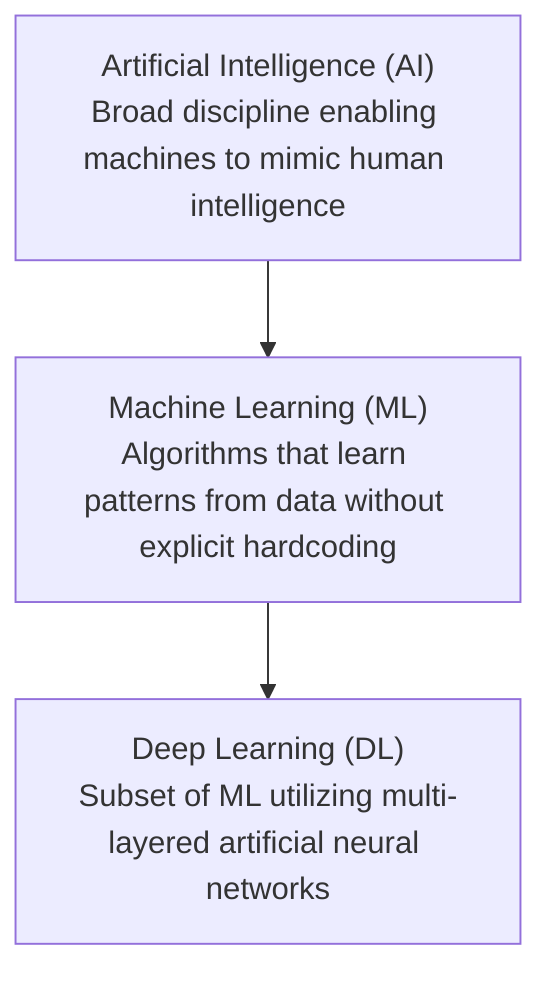
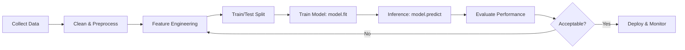

# Machine Learning Fundamentals: Study Guide & Reference

A structured, beginner-to-intermediate guide covering core Machine Learning concepts, algorithms, workflows, evaluation metrics, and practical implementations.

---

## Table of Contents
1. [AI Hierarchy: AI vs. ML vs. DL](#1-ai-hierarchy-ai-vs-ml-vs-dl)
2. [Types of Machine Learning](#2-types-of-machine-learning)
   - [Supervised Learning](#supervised-learning)
   - [Unsupervised Learning](#unsupervised-learning)
   - [Reinforcement Learning](#reinforcement-learning)
3. [The End-to-End Machine Learning Workflow](#3-the-end-to-end-machine-learning-workflow)
4. [Data Representation & Splitting](#4-data-representation--splitting)
5. [Core Algorithms Overview](#5-core-algorithms-overview)
   - [Linear Regression](#linear-regression)
   - [Logistic Regression](#logistic-regression)
   - [K-Nearest Neighbors (KNN)](#k-nearest-neighbors-knn)
   - [Decision Trees](#decision-trees)
   - [Random Forest](#random-forest)
   - [Support Vector Machines (SVM)](#support-vector-machines-svm)
6. [Data Preprocessing Techniques](#6-data-preprocessing-techniques)
7. [Model Diagnostics: Overfitting vs. Underfitting](#7-model-diagnostics-overfitting-vs-underfitting)
8. [Evaluation Metrics](#8-evaluation-metrics)
   - [Classification Metrics](#classification-metrics)
   - [Regression Metrics](#regression-metrics)
9. [Hands-on Scikit-Learn Template](#9-hands-on-scikit-learn-template)
10. [Quick Revision Summary & Cheatsheet](#10-quick-revision-summary--cheatsheet)

---

## 1. AI Hierarchy: AI vs. ML vs. DL



- **Artificial Intelligence (AI):** The overarching science of making intelligent machines. Includes rule-based systems, expert systems, and search heuristics.
- **Machine Learning (ML):** A branch of AI focused on statistical algorithms that parse data, identify underlying patterns, and make informed predictions or decisions.
- **Deep Learning (DL):** A specialized subset of ML based on Artificial Neural Networks (ANNs) with multiple hidden layers (e.g., CNNs, RNNs, Transformers).

---

## 2. Types of Machine Learning

| Paradigm | Target Output ($y$) Available? | Primary Objective | Typical Examples |
| :--- | :--- | :--- | :--- |
| **Supervised Learning** | **Yes** (Labeled data) | Learn mapping function: $f(X) \to y$ | Disease diagnosis, price forecasting |
| **Unsupervised Learning** | **No** (Unlabeled data) | Discover hidden structures/clusters | Customer segmentation, anomaly detection |
| **Reinforcement Learning** | **No** (Feedback via rewards/penalties) | Optimize policy over sequential steps | Game playing (AlphaGo), robotics, trading |

---

### Supervised Learning
In supervised learning, each training example consists of an input feature vector $X$ and a corresponding ground-truth label $y$.

#### A. Regression
- **Purpose:** Predict a continuous numerical value.
- **Examples:**
  - Predicting patient length of stay in a hospital (days)
  - Housing prices estimation based on square footage and location
  - Temperature or sales forecasting

#### B. Classification
- **Purpose:** Assign an input to one of two or more discrete categories/classes.
- **Types:**
  - **Binary:** Two classes (e.g., `Spam` vs. `Not Spam`, `Malignant` vs. `Benign`, `Pass` vs. `Fail`).
  - **Multiclass:** Three or more classes (e.g., classifying medical image scans into `Normal`, `Pneumonia`, `COVID-19`).

---

### Unsupervised Learning
The model explores unlabeled data to detect groupings, distributions, or redundancies without external guidance.

- **Clustering (e.g., K-Means, DBSCAN):** Partition data points into groups where items within a group are more similar to each other than to items in other groups.
- **Dimensionality Reduction (e.g., PCA, t-SNE):** Compress high-dimensional feature spaces while preserving variance.

---

### Reinforcement Learning (RL)
Learns through trial-and-error interactions with an dynamic environment.

```
Agent ---- (Action) ----> Environment
  ^                           |
  |--- (State & Reward) ------|
```
- **State ($S$):** Current situation of the agent.
- **Action ($A$):** Move chosen by the agent.
- **Reward ($R$):** Positive feedback for beneficial actions; penalty/negative reward for mistakes.
- **Goal:** Maximize cumulative expected reward over time.

---

## 3. The End-to-End Machine Learning Workflow



1. **Problem Definition:** Clarify business/clinical objective, metrics, and data feasibility.
2. **Data Ingestion & Cleaning:** Handle missing fields, duplicates, and outliers.
3. **Feature Engineering & Transformation:** Encode categoricals, normalize scales.
4. **Data Splitting:** Divide into separate training, validation, and test subsets.
5. **Model Training:** Fit model parameters on training partition.
6. **Evaluation & Tuning:** Benchmark on validation/test set, tune hyperparameters.
7. **Deployment & Monitoring:** Serve via API, track data drift and performance decay.

---

## 4. Data Representation & Splitting

- **Feature Matrix ($X$):** The independent variables. Shaped $(N, D)$ where $N$ is samples and $D$ is feature dimensions.
- **Target Vector ($y$):** The dependent variable / ground-truth output. Shaped $(N,)$ or $(N, K)$.

### Standard Train/Test Split Rule
- **Training Set (~80%):** Used by the learning algorithm to calculate internal parameters (weights, coefficients, tree splits).
- **Testing Set (~20%):** Unseen data reserved solely to assess generalization ability.

```python
from sklearn.model_selection import train_test_split

X_train, X_test, y_train, y_test = train_test_split(
    X, y, test_size=0.20, random_state=42, stratify=y  # stratify for classification
)
```

---

## 5. Core Algorithms Overview

### Linear Regression
- **Task:** Regression.
- **Equation:** $\hat{y} = w_1 x_1 + w_2 x_2 + \dots + w_n x_n + b$
- **Intuition:** Finds the best-fitting straight line (or hyperplane) minimizing Mean Squared Error (MSE).

### Logistic Regression
- **Task:** Classification.
- **Equation:** $P(y=1|X) = \sigma(z) = \frac{1}{1 + e^{-z}}$, where $z = W^T X + b$.
- **Intuition:** Applies the Sigmoid (logistic) function to map linear outputs between $0$ and $1$, representing class probabilities.

### K-Nearest Neighbors (KNN)
- **Task:** Classification & Regression.
- **Mechanism:** Non-parametric, instance-based. Computes distance (e.g., Euclidean distance) to all points and takes the majority class among the $k$ closest neighbors.

### Decision Trees
- **Task:** Classification & Regression.
- **Mechanism:** Builds an inverted tree structure by greedily splitting features based on impurity criteria (Gini Impurity, Information Gain / Entropy).
- **Pros:** Highly interpretable ("If Age > 50 and BP > 140 -> High Risk").

### Random Forest
- **Task:** Classification & Regression.
- **Mechanism:** Ensemble of multiple Decision Trees using:
  1. **Bagging (Bootstrap Aggregating):** Training each tree on random subsets with replacement.
  2. **Feature Subsampling:** Randomly picking subsets of features at each split.
- **Pros:** Drastically reduces variance and resists overfitting compared to individual trees.

### Support Vector Machines (SVM)
- **Task:** Classification (primarily) and Regression.
- **Core Concepts:**
  - **Hyperplane:** Decision boundary separating distinct classes.
  - **Support Vectors:** The data points situated closest to the decision boundary.
  - **Margin:** Distance between the hyperplane and support vectors. SVM maximizes this margin.
  - **Kernel Trick:** Projects non-linearly separable data into higher-dimensional space:
    - Linear Kernel
    - Radial Basis Function (RBF)
    - Polynomial Kernel

---

## 6. Data Preprocessing Techniques

| Step | Technique | Purpose / Example |
| :--- | :--- | :--- |
| **Missing Values** | Imputation | Mean/Median/Mode imputation or KNN imputer. |
| **Categorical Encoding** | One-Hot Encoding | Binary indicator columns for nominal categories (`Red`, `Green`, `Blue`). |
| | Label Encoding | Ordinal integers (`Low` &rarr; 0, `Medium` &rarr; 1, `High` &rarr; 2). |
| **Feature Scaling** | **Standardization** ($Z$-score) | $z = \frac{x - \mu}{\sigma}$ (Centers at mean 0, variance 1). Recommended for SVM, KNN, Logistic Regression. |
| | **Normalization** (Min-Max) | $x_{norm} = \frac{x - x_{min}}{x_{max} - x_{min}}$ (Scales values strictly between $[0, 1]$). |

---

## 7. Model Diagnostics: Overfitting vs. Underfitting

```
   High Error
        ^
        |     Underfitting                   Overfitting
        |     (High Bias)                   (High Variance)
        |          \                             /
        |           \    Optimal Balance        /
        |            \         |               /
        +---------------------------------------------> Model Complexity
```

| State | Training Accuracy | Test/Validation Accuracy | Diagnosis | Remedies |
| :--- | :--- | :--- | :--- | :--- |
| **Underfitting** | Low | Low | Model is too simple to capture patterns (High Bias). | Increase model capacity, add polynomial features, reduce regularization. |
| **Good Fit** | High | High | Generalizes effectively to new data. | Ready for testing & deployment. |
| **Overfitting** | Very High | Low | Model memorized training noise/outliers (High Variance). | Add more training data, apply regularization ($L_1/L_2$), prune trees, apply dropout. |

---

## 8. Evaluation Metrics

### Classification Metrics

1. **Confusion Matrix:**
   - **True Positive (TP):** Correctly predicted positive.
   - **True Negative (TN):** Correctly predicted negative.
   - **False Positive (FP):** Type I error (incorrect positive alert).
   - **False Negative (FN):** Type II error (missed positive case).

2. **Accuracy:**
   $$\text{Accuracy} = \frac{TP + TN}{TP + TN + FP + FN}$$

3. **Precision:**
   $$\text{Precision} = \frac{TP}{TP + FP}$$
   *(When the model predicts positive, how often is it right? Critical when FP is costly, e.g., spam filter).*

4. **Recall (Sensitivity):**
   $$\text{Recall} = \frac{TP}{TP + FN}$$
   *(Out of all actual positive cases, how many did the model find? Critical in healthcare to avoid missing diseased patients).*

5. **F1-Score:**
   $$\text{F1} = 2 \times \frac{\text{Precision} \times \text{Recall}}{\text{Precision} + \text{Recall}}$$
   *(Harmonic mean of precision and recall; ideal for imbalanced datasets).*

---

### Regression Metrics

| Metric | Formula | Characteristic |
| :--- | :--- | :--- |
| **Mean Absolute Error (MAE)** | $\frac{1}{n} \sum \|y - \hat{y}\|$ | Linear error penalty; robust to outliers. |
| **Mean Squared Error (MSE)** | $\frac{1}{n} \sum (y - \hat{y})^2$ | Penalizes large errors heavily; non-linear. |
| **Root Mean Squared Error (RMSE)** | $\sqrt{\text{MSE}}$ | Expressed in the exact same units as target variable $y$. |
| **$R^2$ Score (Coefficient of Determination)** | $1 - \frac{\sum (y - \hat{y})^2}{\sum (y - \bar{y})^2}$ | Proportion of target variance explained by features ($1.0$ is perfect). |

---

## 9. Hands-on Scikit-Learn Template

```python
import numpy as np
from sklearn.datasets import load_breast_cancer
from sklearn.model_selection import train_test_split
from sklearn.preprocessing import StandardScaler
from sklearn.ensemble import RandomForestClassifier
from sklearn.metrics import classification_report, confusion_matrix

# 1. Load data
data = load_breast_cancer()
X, y = data.data, data.target

# 2. Split data (80% train, 20% test)
X_train, X_test, y_train, y_test = train_test_split(
    X, y, test_size=0.20, random_state=42, stratify=y
)

# 3. Preprocess / Scale features
scaler = StandardScaler()
X_train_scaled = scaler.fit_transform(X_train)
X_test_scaled = scaler.transform(X_test)  # Note: only transform test set

# 4. Initialize and train model
model = RandomForestClassifier(n_estimators=100, random_state=42)
model.fit(X_train_scaled, y_train)

# 5. Predict on unseen test data
y_pred = model.predict(X_test_scaled)

# 6. Evaluate
print("Confusion Matrix:")
print(confusion_matrix(y_test, y_pred))
print("\nClassification Report:")
print(classification_report(y_test, y_pred, target_names=data.target_names))
```

---

## 10. Quick Revision Summary & Cheatsheet

- **AI &rarr; ML &rarr; DL**: AI is the broad concept; ML learns from data; DL uses deep neural networks.
- **Supervised**: Labeled data with known targets ($y$).
  - *Regression*: Predicts continuous numbers.
  - *Classification*: Predicts categorical labels.
- **Unsupervised**: Unlabeled data. Discovers clusters and groupings.
- **Reinforcement**: Learns optimal policy through environment interaction (Reward vs. Penalty).
- **Core API Functions**:
  - `model.fit(X_train, y_train)` &rarr; Learns patterns / fits parameters.
  - `model.predict(X_test)` &rarr; Inferences outputs for new samples.
- **Overfitting**: High training performance, low test performance (memorizes noise).
- **Underfitting**: Poor training and test performance (fails to capture pattern).
- **SVM Triad**:
  - *Hyperplane*: Decision boundary.
  - *Support Vectors*: Points closest to the boundary.
  - *Margin*: Distance between boundary and support vectors (maximized).
